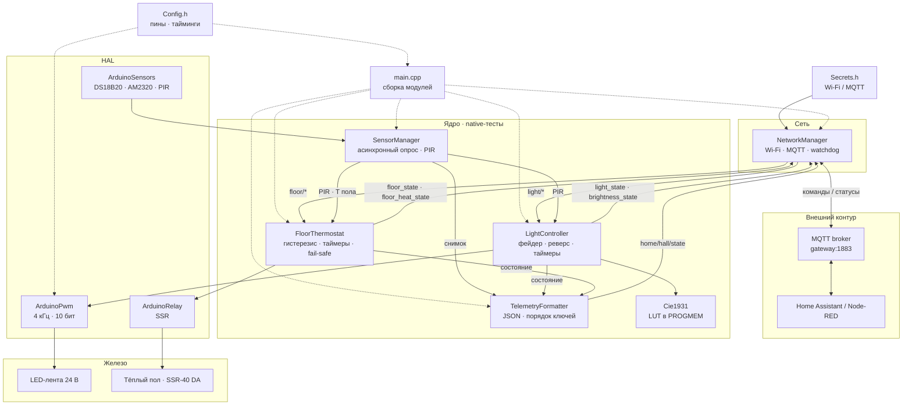

# Smart Home Hall — умный коридор на ESP8266

Прошивка контроллера «умного коридора»: LED-подсветка с плавным розжигом, тёплый пол с термостатом, датчики движения, температуры и влажности, управление и телеметрия по MQTT для Home Assistant и Node-RED.

> **Статус: рефакторинг Argon, блок 4 из 5 завершён.** Датчики опрашиваются неблокирующе, свет управляется времязависимым фейдером, тёплый пол — термостатом с гистерезисом (`FloorThermostat` + `ArduinoRelay`), чистая логика тестируется на хосте (`pio test -e native`). Сеть и MQTT — блок 5 по [плану](docs/superpowers/plans/2026-10-20-argon-refactoring.md). Аппаратная часть и MQTT-контракт не меняются.

## Возможности

- **Свет.** LED-лента 24 В (122 Вт): ШИМ 4 кГц / 10 бит, кривая CIE1931, плавный переход 2 с, реверс с текущей яркости при обратной команде.
- **Автосвет по движению.** PIR включает свет и продлевает таймеры; бездействие выключает свет через 1 минуту (режим движения) или 1 час (защитный режим).
- **Тёплый пол.** Мастер-выключатель, авторежим по движению, гистерезис ±0.5 °C, таймауты 1 ч / 12 ч, коммутация через SSR-40 DA.
- **Датчики.** DS18B20 (температура пола, 1-Wire), AM2320 (температура и влажность воздуха, I²C), PIR.
- **MQTT.** Команды, retain-статусы и JSON-телеметрия каждые 10 секунд.
- **Живучесть.** Автопереподключение Wi-Fi/MQTT (попытка раз в 5 секунд) и `ESP.restart()` после 5 минут без связи.
- **Безопасный старт.** После подачи питания всё выключено, состояния публикуются в MQTT, PIR игнорируется первые 10 секунд.

## Архитектура



Сплошные стрелки — вызовы и события, пунктир — конфигурация и сборка. `main.cpp` — composition root: он создаёт модули и связывает их, а чистое ядро не зависит от Arduino и проверяется через `pio test -e native`.

## Железо

| Компонент | Подключение | Примечание |
|---|---|---|
| MCU | Wemos D1 Mini (ESP8266) | Платформа `espressif8266`, Arduino framework |
| Питание | 24 В → XL4015 → 5 В | Питание Wemos |
| Питание драйвера | 24 В → L7812 → 12 В | Питание драйвера MOSFET |
| LED-лента 24 В, 122 Вт | **D7** (GPIO13) → TC4420 → IRFZ48N | ШИМ, прямая логика: 0 = выкл, 1023 = максимум |
| Тёплый пол, SSR-40 DA 600 Вт | **D8** (GPIO15) через BS170 | Активный высокий уровень |
| DS18B20 (пол) | **D5** (GPIO14) | 1-Wire |
| AM2320 (воздух) | **D1** (GPIO5) — SCL, **D2** (GPIO4) — SDA | I²C |
| PIR (движение) | **D6** (GPIO12) | Цифровой вход |

Пины и схема зафиксированы: устройство собрано и работает, при рефакторинге они не меняются.

> ⚠️ Устройство коммутирует нагреватель через SSR и питается от 24 В — при сборке и подключении соблюдайте технику безопасности. Прошивка не заменяет аппаратную защиту.

## MQTT API

Базовый префикс — `home/hall`, client ID — `ESP8266_Smart_Hall`. Брокер — Mosquitto на шлюзе по умолчанию (`WiFi.gatewayIP()`), порт 1883.

### Команды (контроллер подписан, без retain)

| Топик | Payload | Описание |
|---|---|---|
| `home/hall/light/light` | `ON` / `OFF` | Мастер-выключатель света |
| `home/hall/light/brightness` | `1`…`100` | Яркость, % |
| `home/hall/light/moveDetection` | `ON` / `OFF` | Автосвет по движению |
| `home/hall/floor/floor` | `ON` / `OFF` | Мастер-выключатель пола |
| `home/hall/floor/moveDetection` | `ON` / `OFF` | Автопол по движению |
| `home/hall/floor/targetTemp` | float, °C | Уставка пола (camelCase!) |

Любая команда света сбрасывает таймер света, любая команда пола — таймер пола; срабатывание PIR сбрасывает оба таймера.

### Состояния (контроллер публикует)

| Топик | Payload | Retain | Когда публикуется |
|---|---|---|---|
| `home/hall/light/light_state` | `ON` / `OFF` | да | Мгновенно при изменении состояния, не дожидаясь окончания перехода |
| `home/hall/light/brightness_state` | `1`…`100` | да | По завершении плавного перехода |
| `home/hall/light/moveDetection_state` | `ON` / `OFF` | да | При смене режима |
| `home/hall/light/move` | `ON` / `OFF` | нет | По фронтам PIR |
| `home/hall/floor/floor_state` | `ON` / `OFF` | да | Мастер-состояние пола |
| `home/hall/floor/floor_heat_state` | `ON` / `OFF` | да | Только при реальном переключении реле SSR |
| `home/hall/floor/moveDetection_state` | `ON` / `OFF` | да | При смене режима |
| `home/hall/floor/targetTemp` | float, °C | да | При первом подключении — `30.0` |
| `home/hall/state` | JSON | нет | Каждые 10 секунд |

При первом подключении к MQTT контроллер один раз публикует все `*_state` = `OFF`, `brightness_state` = `100` и `targetTemp` = `30.0`.

### Телеметрия

`home/hall/state`, каждые 10 секунд, `retain = false`. Порядок ключей фиксирован — его разбирают Node-RED/MySQL:

```json
{"light_state":"ON","light_move_state":"ON","floor_state":"ON","floor_move_state":"ON","floor_heat_state":"OFF","floor_temp":27.4,"air_temp":22.1,"air_hum":41.5,"pir_raw":false,"since_move_s":37,"uptime":86400,"heap":31240}
```

| Поле | Тип | Описание |
|---|---|---|
| `light_state` | string | Логическое состояние света |
| `light_move_state` | string | Режим автосвета |
| `floor_state` | string | Мастер-состояние пола |
| `floor_move_state` | string | Режим автопола |
| `floor_heat_state` | string | Фактическое состояние реле |
| `floor_temp` | number \| null | Температура пола, °C |
| `air_temp` | number \| null | Температура воздуха, °C |
| `air_hum` | number \| null | Влажность воздуха, % |
| `pir_raw` | bool | Текущий уровень PIR |
| `since_move_s` | number | Секунд с последнего сброса таймера света |
| `uptime` | number | Секунд с момента старта |
| `heap` | number | Свободная память, байт |

Ошибки датчиков (`-127`, `85`, `NaN`, а для пола также `0 °C` — как в легаси) передаются как `null`.

### Тайминги

| Параметр | Значение |
|---|---|
| ШИМ | 4 кГц, 10 бит (0…1023) |
| Плавный переход | 2 с: 100 шагов × 20 мс |
| Прогрев PIR после старта | 10 с |
| Свет: таймаут при движении | 1 мин |
| Свет: защитный таймаут | 1 ч |
| Пол: таймаут при движении | 1 ч |
| Пол: защитный таймаут | 12 ч |
| Гистерезис пола | ±0.5 °C |
| Опрос AM2320 | 15 с |
| Опрос DS18B20 | 30 с, асинхронно (без блокировки `loop()`) |
| Телеметрия | 10 с |
| Watchdog связи | 5 мин → `ESP.restart()` |

## Сборка и прошивка

**Требования:** [PlatformIO Core](https://docs.platformio.org/en/latest/core/installation/) (CLI) или VS Code с расширением PlatformIO IDE; драйвер USB-UART (CH340/CP210x).

```bash
git clone git@github.com:alexam3r/Smart.Home.Hall.git
cd Smart.Home.Hall

# если pio не в PATH:
export PATH="$HOME/.platformio/penv/bin:$PATH"

pio run                  # сборка
pio run -t upload        # прошивка, 921600 бод
pio device monitor       # Serial 115200
```

Полный цикл с монитором: `pio run -t upload -t monitor`.

> Сейчас в прошивке: каркас, безопасный старт, датчики, свет и тёплый пол. Сеть и MQTT — блок 5; легаси-файл остаётся эталоном поведения и в сборке не участвует.

### Тесты

Чистая логика (кривая, таймеры, гистерезис, JSON) проверяется на хосте:

```bash
pio test -e native
```

### Секреты

Wi-Fi и MQTT-учётные данные в код не коммитятся. В репозитории есть только шаблон `include/Secrets.h.example`; локально создайте `include/Secrets.h` (файл в `.gitignore`):

```cpp
#define WIFI_SSID "your-ssid"
#define WIFI_PASS "your-password"
#define MQTT_USER "mqtt-user"
#define MQTT_PASS "mqtt-password"
```

## Структура репозитория

```text
.
├── PRD.md             # ТЗ на рефакторинг (источник правды)
├── README.md          # этот файл
├── AGENTS.md          # правила для AI-агентов
├── CLAUDE.md          # обёртка Claude Code → AGENTS.md
├── platformio.ini     # env d1_mini + native, зависимости
├── docs/
│   └── main.cpp       # легаси-монолит — эталон поведения
├── src/
│   ├── main.cpp       # сборка модулей и loop
│   ├── core/          # SensorManager, LightController, FloorThermostat
│   └── hal/           # ArduinoSensors, ArduinoPwm, ArduinoRelay
├── include/           # Config.h, MqttTopics.h, core/, hal/, Secrets.h.example
├── test/              # native-тесты (smoke, sensors)
├── graphify-out/      # архитектурный граф (graph.json, GRAPH_REPORT.md)
├── _Ф1_верх.gbr       # Gerber верхнего слоя платы
└── .vscode/           # настройки PlatformIO IDE
```

## Рефакторинг

Монолит `docs/main.cpp` разбивается на модули: `Config`, `Secrets`, `NetworkManager`, `LightController`, `FloorThermostat`, `SensorManager`, `Telemetry`. Причина зависаний анимации — блокирующие чтения датчиков (DS18B20 до 750 мс, AM2320 до ~600 мс при сбоях): в новой прошивке опрос асинхронный, а фейдер считается по прошедшему времени.

| № | Блок | Статус |
|---|---|---|
| 1 | Инфраструктура: `platformio.ini`, `Secrets.h` + шаблон, `.gitignore`, каркас | ✅ |
| 2 | Датчики и устранение блокировок | ✅ |
| 3 | Свет: `LightController`, таблица CIE1931 в `PROGMEM` | ✅ |
| 4 | Тёплый пол: `FloorThermostat` | ✅ |
| 5 | Сеть, MQTT и телеметрия | — |

Порядок работы и критерии готовности — в [`AGENTS.md`](AGENTS.md), §9 и §12. Полные требования — в [`PRD.md`](PRD.md).

## Документация

- [`PRD.md`](PRD.md) — техническое задание и бизнес-логика.
- [`AGENTS.md`](AGENTS.md) — правила для AI-агентов, инварианты, workflow.
- [`CLAUDE.md`](CLAUDE.md) — входная точка для Claude Code.
- [`docs/main.cpp`](docs/main.cpp) — текущая рабочая прошивка (легаси).
- [`docs/freeze-analysis.md`](docs/freeze-analysis.md) — разбор причин зависаний анимации на 1–2 с.
- [`docs/superpowers/plans/2026-10-20-argon-refactoring.md`](docs/superpowers/plans/2026-10-20-argon-refactoring.md) — план реализации рефакторинга.
- [`graphify-out/GRAPH_REPORT.md`](graphify-out/GRAPH_REPORT.md) — архитектурный граф проекта (graphify).
